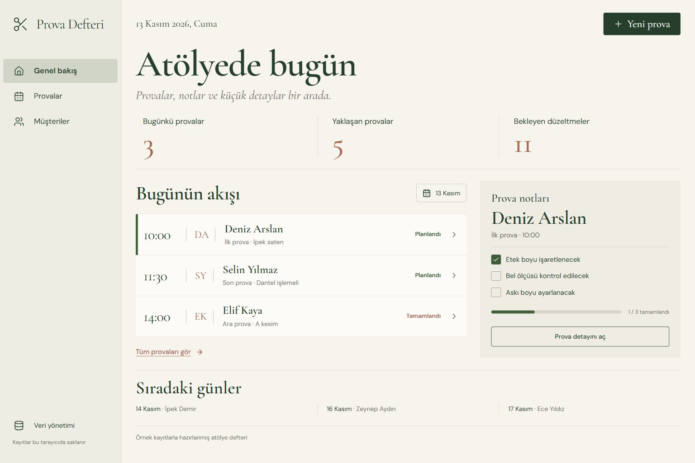
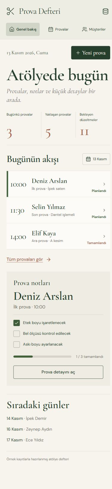

# Prova Defteri

Gelinlik atölyeleri için müşteri, prova randevusu ve düzeltme takibini tek yerde toplayan web uygulaması. Proje, GelinlikOS fikriyle ilişkili bağımsız bir frontend çalışmasıdır.

**Amaç:** Bir provanın hangi müşteriye ait olduğunu, ne zaman yapılacağını ve hangi düzeltmelerin beklediğini kolayca görmek. Uygulamanın açılışındaki müşteri ve prova verileri tamamen kurgudur.

## Uygulamanın kapsamı

- **Genel Bakış:** Bugünün ve yaklaşan provaların özeti, iş durumlarını gösteren özet kartları.
- **Provalar:** Müşteriye bağlı prova oluşturma, düzenleme ve silme; tarih, saat, tür, durum, düzeltme maddeleri ve notlar.
- **Müşteriler:** Müşteri kaydı oluşturma, düzenleme, silme ve ilgili provaları inceleme.
- Arama, durum filtresi ve prova ayrıntıları için detay çekmecesi.
- Değişiklikleri tarayıcıdaki `localStorage` alanına kaydetme.
- Aynı atölyede çakışan prova saatlerini kontrol etme.
- JSON biçiminde yedek alma ve uygun yedek dosyasını geri yükleme.

Uygulama verileri kullanılan tarayıcı ve site adresinde saklanır. Sayfayı yenilemek kayıtları silmez; tarayıcı verilerini temizlemek silebilir. Sunucu veritabanı, çok kullanıcılı eşitleme veya kullanıcı hesabı bu sürümün kapsamına dahil değildir.

## Teknolojiler

| Teknoloji | Kullanım amacı |
|---|---|
| React | Bileşen tabanlı arayüz ve durum yönetimi |
| Vite | Geliştirme sunucusu ve üretim derlemesi |
| TypeScript | Müşteri/prova veri modelleri ve tür kontrolü |
| HTML, CSS ve JavaScript | Anlamsal sayfa yapısı, duyarlı görünüm ve kullanıcı etkileşimleri |
| Saf CSS | Düzen, renkler, tipografi ve farklı ekranlara uyum |
| Lucide React | Arayüz simgeleri |
| `localStorage` | Tarayıcıda kalıcı veri saklama |

## Kurulum ve çalıştırma

**Gereksinim:** Node.js 22.12 veya üzeri; Node.js 24 önerilir. npm kurulu olmalıdır. Komutları projenin bulunduğu klasörde çalıştırın.

```sh
npm install
npm run dev
```

Terminalde yazan yerel adresi tarayıcıda açın. Üretim sürümünü derlemek ve yerelde önizlemek için:

```sh
npm run build
npm run preview
```

Otomatik kontroller için:

```sh
npm test
npm run typecheck
```

**Doğrulama:** 14 otomatik test geçti. TypeScript denetimi ve üretim derlemesi başarılı. Müşteri/prova işlemleri, form doğrulama, saat çakışması, düzeltme maddeleri, sayfa yenilendiğinde kayıtların korunması ve mobil görünüm tarayıcıda kontrol edildi. Ayrıntılar [teslim kontrol belgesinde](docs/TESLIM_KONTROLU.md).

## Kısa kullanım senaryosu

1. Müşteriler ekranında bir müşteri oluşturun.
2. Provalar ekranından müşteriye bağlı bir prova ekleyin; tarih, saat ve türünü belirtin.
3. Prova ayrıntılarını açıp yapılacak düzeltmeleri ve notları ekleyin.
4. Düzeltme maddelerini tamamlayın, prova durumunu güncelleyin.
5. Arama ve durum filtresini kullanın; Genel Bakış ekranındaki özetleri kontrol edin.
6. Sayfayı yenileyerek kaydın korunduğunu doğrulayın.

## Yapay zekâ kullanımı

Geliştirmede **OpenAI Codex** asistanı kullanıldı. Problem ve kapsamın belirlenmesi, ekran/veri modeli planı, arayüz ve kod geliştirme, kod incelemesi, test senaryoları ve dokümantasyonda yardımcı oldu. Katkılar [AI kullanım belgesinde](docs/AI_KULLANIMI.md) açıklanır.

Üründe çalışan bir yapay zekâ modeli veya AI API'si yoktur. Kartlardaki sayılar ve listeler, kayıtlardan hesaplanan özetlerdir. Proje yönergesindeki AI şartı, geliştirme sürecinde asistan kullanımıyla ele alınır.

## Ekran görüntüleri ve teslim bağlantıları

| Teslim öğesi | Durum |
|---|---|
| Masaüstü ekran görüntüsü | `screenshots/desktop.jpg`; 1.536 piksel genişlikte kontrol edildi. |
| Mobil ekran görüntüsü | `screenshots/mobile.jpg`; 390 piksel genişlikte kontrol edildi. |
| Herkese açık GitHub deposu | [kardelenaldemir/prova-defteri](https://github.com/kardelenaldemir/prova-defteri); depo oluşturuldu, kaynak kod aktarımı sürüyor. |
| Canlı uygulama | Henüz oluşturulmadı; yayın ve erişim kontrolünden sonra gerçek adres eklenecek. |

Masaüstü görünümü:



Mobil görünümü:



## Proje belgeleri

- [Proje planı ve veri modeli](docs/PROJE_PLANI.md)
- [AI kullanım kaydı](docs/AI_KULLANIMI.md)
- [Yönerge ve teslim kontrolü](docs/TESLIM_KONTROLU.md)
